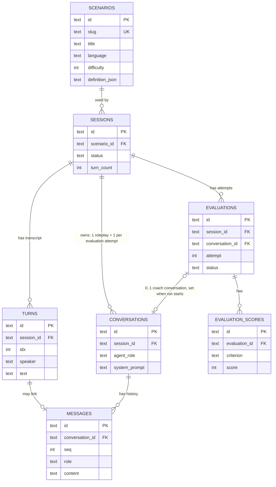

# EchoRole – Database Schema

| | |
|---|---|
| Status | **Approved v0.3; implemented through Alembic `0002`. See [current project status](../PROJECT_STATUS.md) for acceptance gaps.** |
| Version | 0.3.0 |
| Engine | SQLite 3 (WAL), SQLAlchemy 2.0, Alembic |
| Owner | M1 Platform |
| Related | [System architecture](./system-architecture.md), [API contracts](../api-contracts/API_CONTRACTS.md), [Development plan](./development-plan.md) |

## Change Log

| Version | Changes |
|---|---|
| 0.3.0 | **Fix:** Coach history description no longer lists metrics (Coach receives transcript + scenario task + rubric only). ERD redrawn: a session owns many conversations (one roleplay, plus one per evaluation attempt); an evaluation links to 0..1 coach conversation. `evaluations.conversation_id` is now `UNIQUE`. `conversations.model` / `evaluations.model` are filled from `LLMClient.model_for(profile)` when the row is created (previously the model was not yet known). Lazy idle-timeout rules cross-referenced to API_CONTRACTS §6.9. Invariants 10–11 added. |
| 0.2.0 | `evaluations.rubric_version` added. `evaluations.overall_score` is **backend-computed** (never LLM-supplied). `evaluation_scores.weight_percent` added (weight snapshot per score row). Clarified that `metrics_json` (deterministic) and `result_json` (qualitative Coach output) are separate. `conversations.model` / `evaluations.model` documented as the model resolved by the LLM Gateway. Invariants 6–8 added. Scenario `language` fixed to `en` (validated in schemas). |
| 0.1.0 | Initial draft. |

## 1. Conventions

- Primary keys: `TEXT`, prefixed UUID4 hex (`ses_3f9a…`).
- Timestamps: `TEXT` ISO‑8601 UTC (`2026-11-13T10:15:00Z`).
- Enums: `TEXT` + `CHECK` constraint.
- JSON: `TEXT` holding JSON (validated by Pydantic before write). SQLite JSON1 functions may be used for reads.
- Required pragmas on every connection: `journal_mode=WAL`, `foreign_keys=ON`, `busy_timeout=5000`.
- No soft deletes in MVP. `ON DELETE CASCADE` from `sessions` to children.
- Audio is **never** stored.

## 2. Entity Relationship Diagram

Reading the diagram: `conversations.agent_role` distinguishes the two kinds. A session has **at most one** `roleplay` conversation (partial unique index) and **zero or more** `evaluation` conversations — exactly one per evaluation attempt, referenced by `evaluations.conversation_id` (`UNIQUE`; `NULL` while the attempt is `pending`). Evaluation conversations also carry `session_id` so they cascade-delete with the session, but they are never shared between attempts.

## 3. Tables

### 3.1 `scenarios`
Seeded from `backend/app/simulation/scenarios/*.json` on startup (upsert by `slug`). Read-only via API in MVP.

| Column | Type | Constraints | Notes |
|---|---|---|---|
| id | TEXT | PK | `scn_…` |
| slug | TEXT | NOT NULL, UNIQUE | stable key, e.g. `job-interview-behavioral` |
| title | TEXT | NOT NULL | |
| description | TEXT | NOT NULL | shown to the user |
| language | TEXT | NOT NULL DEFAULT `'en'`, CHECK = `'en'` | English-only MVP; relaxing this is a contract change |
| difficulty | INTEGER | NOT NULL, CHECK 1–3 | |
| max_turns | INTEGER | NOT NULL DEFAULT 8, CHECK 1–30 | candidate turns |
| definition_json | TEXT | NOT NULL | persona, task, success criteria, evaluation focus (see `ScenarioDefinition` in API_CONTRACTS §5.1). `evaluation_focus` only tells the Coach where to elaborate feedback; it never changes rubric weights |
| created_at | TEXT | NOT NULL | |
| updated_at | TEXT | NOT NULL | |

### 3.2 `sessions`

| Column | Type | Constraints | Notes |
|---|---|---|---|
| id | TEXT | PK | `ses_…` |
| scenario_id | TEXT | NOT NULL, FK → scenarios(id) | |
| status | TEXT | NOT NULL, CHECK IN (`created`,`active`,`ended`,`abandoned`) | |
| end_reason | TEXT | NULL, CHECK IN (`user_ended`,`max_turns`,`agent_concluded`,`timeout`) | set when ended/abandoned |
| turn_count | INTEGER | NOT NULL DEFAULT 0 | number of **candidate** turns |
| in_flight | INTEGER | NOT NULL DEFAULT 0, CHECK IN (0,1) | concurrency guard for turn processing |
| created_at | TEXT | NOT NULL | |
| started_at | TEXT | NULL | |
| ended_at | TEXT | NULL | |
| last_activity_at | TEXT | NOT NULL | set on create, start, each accepted turn, end; **not** by reads. Drives lazy idle timeout (API_CONTRACTS §6.9) |

Indexes: `idx_sessions_status_created (status, created_at DESC)`, `idx_sessions_scenario (scenario_id)`.

### 3.3 `turns` (the user-visible transcript)

| Column | Type | Constraints | Notes |
|---|---|---|---|
| id | TEXT | PK | `trn_…` |
| session_id | TEXT | NOT NULL, FK → sessions(id) ON DELETE CASCADE | |
| idx | INTEGER | NOT NULL | 0-based position in the transcript |
| speaker | TEXT | NOT NULL, CHECK IN (`interviewer`,`candidate`) | |
| speaker_id | TEXT | NULL | Panel persona ID for generated interviewer turns; null for legacy turns and candidates |
| speaker_name | TEXT | NULL | Panel persona name for generated interviewer turns; null for legacy turns and candidates |
| text | TEXT | NOT NULL | |
| source | TEXT | NOT NULL, CHECK IN (`typed`,`speech`,`generated`) | `generated` for interviewer |
| speech_meta_json | TEXT | NULL | candidate speech only: `duration_ms`, `avg_confidence`, `word_count`, `language` |
| llm_meta_json | TEXT | NULL | interviewer only: model, latency_ms, tokens |
| created_at | TEXT | NOT NULL | |

Constraints: `UNIQUE (session_id, idx)`. Index: `idx_turns_session_idx (session_id, idx)`.

### 3.4 `conversations` (one per agent context)

| Column | Type | Constraints | Notes |
|---|---|---|---|
| id | TEXT | PK | `cnv_rp_…` or `cnv_ev_…` |
| session_id | TEXT | NOT NULL, FK → sessions(id) ON DELETE CASCADE | |
| agent_role | TEXT | NOT NULL, CHECK IN (`roleplay`,`evaluation`) | |
| system_prompt | TEXT | NOT NULL | exact prompt used (audit/debug) |
| model | TEXT | NOT NULL | model configured for this profile, obtained from `LLMClient.model_for(profile)` by the service that creates the row (M4 for roleplay, M6 for evaluation); never chosen by agents |
| created_at | TEXT | NOT NULL | |

Indexes:
- **Partial unique:** `CREATE UNIQUE INDEX uq_conv_roleplay_per_session ON conversations(session_id) WHERE agent_role='roleplay';`
- `idx_conv_session_role (session_id, agent_role)`.

Evaluation conversations are linked from `evaluations.conversation_id` (one per attempt).

### 3.5 `messages` (LLM-facing history, per conversation)

| Column | Type | Constraints | Notes |
|---|---|---|---|
| id | TEXT | PK | `msg_…` |
| conversation_id | TEXT | NOT NULL, FK → conversations(id) ON DELETE CASCADE | |
| seq | INTEGER | NOT NULL | 0-based order within conversation |
| role | TEXT | NOT NULL, CHECK IN (`user`,`assistant`) | system prompt lives on `conversations`, not here |
| content | TEXT | NOT NULL | |
| turn_id | TEXT | NULL, FK → turns(id) ON DELETE SET NULL | roleplay messages link to transcript turns |
| created_at | TEXT | NOT NULL | |

Constraints: `UNIQUE (conversation_id, seq)`.

Mapping for roleplay: candidate turn → `role='user'`; interviewer turn → `role='assistant'`. For the coach: one `user` message (rendered transcript with turn ids + scenario task + rubric descriptions — **never delivery metrics**) and one `assistant` message (raw JSON output); a retry appends a corrective `user` message and a second `assistant` message.

> **Why both `turns` and `messages`?** `turns` is the product-facing transcript (with speech metadata, shown in UI and evaluated). `messages` is each agent's private LLM context. Keeping them separate guarantees the Coach history can never contain Roleplay internals.

### 3.6 `evaluations`

| Column | Type | Constraints | Notes |
|---|---|---|---|
| id | TEXT | PK | `evl_…` |
| session_id | TEXT | NOT NULL, FK → sessions(id) ON DELETE CASCADE | |
| conversation_id | TEXT | NULL, **UNIQUE**, FK → conversations(id) | coach conversation, set when the run starts (SQLite permits many NULLs under UNIQUE, so pending attempts do not collide). The referenced row must have `agent_role='evaluation'` (tested) |
| attempt | INTEGER | NOT NULL DEFAULT 1 | |
| status | TEXT | NOT NULL, CHECK IN (`pending`,`running`,`completed`,`failed`) | |
| rubric_version | TEXT | NOT NULL | e.g. `'1.0'`; identifies the weights/descriptions used |
| overall_score | INTEGER | NULL, CHECK 0–100 | **computed by the backend** from `evaluation_scores` and rubric weights: `(Σ weight_percent × score + 5) // 10`. Never taken from the LLM |
| summary | TEXT | NULL | Coach qualitative summary |
| result_json | TEXT | NULL | Coach qualitative content only: `task_outcome`, `strengths`, `improvements`, `next_task`. Contains no delivery numbers and no scores |
| metrics_json | TEXT | NULL | deterministic `DeliveryMetrics` only; no judgements. Written as soon as computed, so a `failed` evaluation can still carry metrics |
| error_code | TEXT | NULL | set when `failed` |
| error_message | TEXT | NULL | |
| model | TEXT | NULL | `NULL` while `pending`; set from `model_for(EVALUATION)` when the run starts, so it is non-null for `running`, `completed` and `failed` |
| created_at | TEXT | NOT NULL | |
| completed_at | TEXT | NULL | |

Constraints: `UNIQUE (session_id, attempt)`. Index: `idx_eval_session (session_id, attempt DESC)`.
"Current evaluation" of a session = highest `attempt`.

### 3.7 `evaluation_scores`

| Column | Type | Constraints | Notes |
|---|---|---|---|
| id | TEXT | PK | |
| evaluation_id | TEXT | NOT NULL, FK → evaluations(id) ON DELETE CASCADE | |
| criterion | TEXT | NOT NULL, CHECK IN (`clarity`,`structure`,`relevance`,`conciseness`,`composure`,`language_accuracy`) | |
| score | INTEGER | NOT NULL, CHECK 0–10 | integer supplied by the Coach |
| weight_percent | INTEGER | NOT NULL, CHECK 0–100 | snapshot of the rubric weight used (backend-set from `rubric.py`) |
| rationale | TEXT | NOT NULL | |
| evidence_turn_ids_json | TEXT | NOT NULL DEFAULT `'[]'` | turn ids that justify the score |

Constraints: `UNIQUE (evaluation_id, criterion)`. Rubric weights (v1.0): relevance 25, structure 20, clarity 20, composure 15, conciseness 10, language_accuracy 10 — sum 100.

> `evaluation_scores` is a separate table (not only JSON) so later phases can aggregate per-criterion progress across sessions with plain SQL.

## 4. Referential / Lifecycle Rules

| Event | Effect |
|---|---|
| `POST /sessions` | insert `sessions(status=created)`; insert roleplay `conversations` row with built system prompt |
| `…/start` | status → `active`; insert one or two interviewer turns (source=generated) with matching assistant messages |
| `…/turns` | in one DB transaction: insert candidate turn + user message, then (after LLM) one or two interviewer turns + assistant messages; `turn_count += 1`. If LLM fails → transaction rolled back, nothing persisted |
| `…/end` | status → `ended`, `ended_at`, `end_reason` |
| `POST …/evaluation` | requires session `ended` and ≥ 1 candidate turn; insert `evaluations(attempt=n+1, status=pending, rubric_version)`; background task writes `metrics_json`, creates the coach `conversations` row, calls the Coach, validates, inserts six `evaluation_scores` rows with weights, computes and stores `overall_score`, then sets `completed` |
| Delete session (future) | cascades to everything |

Invariants (tested):
1. `turns.idx` is gapless per session.
2. A session has exactly one `roleplay` conversation.
3. No `messages` row of an `evaluation` conversation has a `turn_id`.
4. `evaluations` exist only for sessions with `status='ended'`.
5. `conversations.system_prompt` differs between the roleplay and evaluation conversations of one session.
6. For every `completed` evaluation: exactly six `evaluation_scores` rows (one per criterion), `Σ weight_percent = 100`, and `overall_score = (Σ weight_percent × score + 5) // 10`.
7. `evaluations.result_json` never contains `overall_score`, `weight_percent`, or any `DeliveryMetrics` field; `metrics_json` never contains scores or rationale text.
8. Every id in `evaluation_scores.evidence_turn_ids_json` refers to a `candidate`/`interviewer` turn of the same session.
9. No SQL default or CHECK constraint, and no application constant, references a model name; models are stored only as recorded *values* in `conversations.model` / `evaluations.model`.
10. Every non-null `evaluations.conversation_id` points to a conversation with `agent_role='evaluation'` and the same `session_id`; no two evaluations share a conversation.
11. A session in status `abandoned` has `end_reason='timeout'` and no in-flight turn (`in_flight=0`).

## 5. Migration Plan

- `0001_initial.py` – initial tables.
- `0002_panel_speaker_metadata.py` – nullable `turns.speaker_id` and `turns.speaker_name` columns; existing transcript rows remain valid.
- Later phases add migrations only; never edit applied migrations.
- Dev reset: delete `echorole.db`, run `alembic upgrade head`, seed runs on app start.
- File location: `./data/echorole.db` (git-ignored).

## 6. Deliberately Not Included (future phases)

Users/auth, audio blobs, per-token logs, scenario authoring tables, progress analytics views, vector memory.