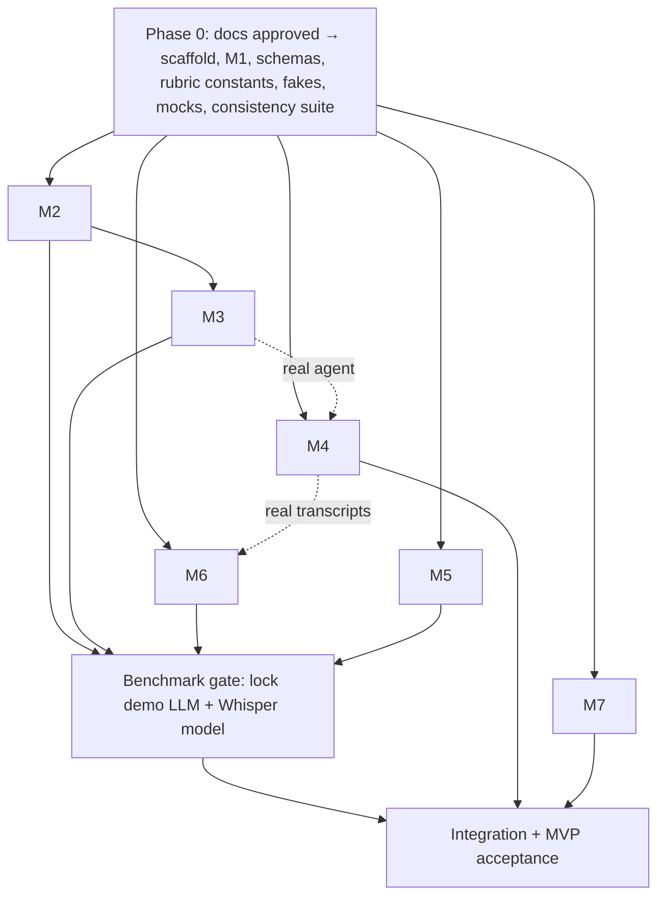

# EchoRole – Development Plan

| | |
|---|---|
| Status | **APPROVED v0.3 – Phase 0 implementation in progress (approval recorded 2026-11-13).** |
| Version | 0.3.0 |
| Related | [System architecture](./system-architecture.md), [API contracts](../api-contracts/API_CONTRACTS.md), [Database schema](./database-schema.md) |

## Change Log

| Version | Changes |
|---|---|
| 0.3.0 | Review fixes: `compute_overall_score` is now implemented and tested in **P0.10** (pure function, needed by the P0.14 consistency suite); `model_for` added to P0.9; P0.6 enforces `UNIQUE(evaluations.conversation_id)`; lazy idle-timeout implementation and tests specified for Track B; M6 no longer tied to M5; staffing rewritten to be team-size-agnostic (5-person example) and Phase 0 critical path stated. |
| 0.2.0 | Exact Phase 0 task breakdown (P0.1–P0.15) with dependencies, files and done-criteria. Consistency suite added as a Phase 0 gate. Model benchmarking gate added to Phase 2 (benchmark tooling built in Phase 1). Track updates: env-driven model/Whisper config, rubric + backend scoring, push-to-talk. Acceptance criteria updated (model switch by env only, no Coach access to metrics, weights sum 100). |
| 0.1.0 | Initial draft. |

## 1. Modules

| ID | Module | Directory | Suggested owner (adjust to team) |
|---|---|---|---|
| M1 | Platform (config, DB, errors, schemas, migrations) | `backend/app/core, schemas, models, migrations` | Tech lead + one backend dev (Phase 0) |
| M2 | LLM Gateway | `backend/app/llm` | Backend dev with LLM experience |
| M3 | Roleplay Agent | `backend/app/roleplay` | Same dev as M2 (prompt engineering) |
| M4 | Simulation Engine | `backend/app/simulation` | Backend dev (Phase 0 DB author) |
| M5 | Speech Engine | `backend/app/speech` | Backend dev |
| M6 | Evaluation Engine + Coach + rubric | `backend/app/evaluation` | Backend dev (independent of M5; may start in parallel) |
| M7 | Frontend | `frontend/` | Frontend dev(s) |

## 2. Dependency Matrix

| Module | Hard dependencies | Soft dependencies (fakes until ready) |
|---|---|---|
| M1 Platform | Approved docs | – |
| M2 LLM Gateway | M1 (`AppError`, config) | – |
| M3 Roleplay Agent | M1 schemas; M2 **interface** (`FakeLLMClient`) | Real M2 for prompt tuning |
| M4 Simulation Engine | M1; M3 **interface** | Real M3 (use `StubRoleplayAgent`) |
| M5 Speech Engine | M1 | – (must not depend on any other module) |
| M6 Evaluation | M1; M2 interface; rubric constants (Phase 0) | Real M4 (use fixture transcripts) |
| M7 Frontend | API contract + MSW mocks | All backends |
| Benchmark gate | M2 real, M3 real, M6 Coach real, M5 real | – |

## 3. Phase 0 – Foundation (exact breakdown)

**Entry condition:** explicit written approval of the four v0.3 documents (recorded 2026-11-13). Branch: `contracts/foundation`. Serial where noted; tasks with the same "Can run with" tag may be done in parallel. Estimates are for one developer-day.

| ID | Task | Depends on | Can run with | Deliverables (paths) | Done when | Est. |
|---|---|---|---|---|---|---|
| **P0.1** | Inventory real repository; map existing code to modules; record in SYSTEM_ARCHITECTURE §0; **no code changes** | approval | – | §0 update | Every existing file maps to a module or "out of scope"; decision D6 closed | 0.5 |
| **P0.2** | Governance: create branch, `CODEOWNERS`, PR template (contract-change checklist), `.gitignore`, `.editorconfig`, `.env.example` (variable names only; model values stay in the local `.env`) | P0.1 | – | repo root files | PR template and CODEOWNERS active; branch protection settings documented in README | 0.5 |
| **P0.3** | Backend scaffold: `pyproject.toml` (pinned deps), `app/main.py` factory, `/api/v1` router mount, ruff/mypy/pytest config, `Makefile` targets (`dev`, `test`, `lint`) | P0.2 | P0.4 | `backend/` | `make test` runs; app boots | 0.5 |
| **P0.4** | Frontend scaffold: Vite + React + TS + Tailwind, eslint, vitest, MSW wiring, dev proxy to `:8000` | P0.2 | P0.3 | `frontend/` | `npm run dev/test/build` green | 0.5 |
| **P0.5** | M1 core: `config.py` (all env vars, required-variable validation with clear startup message, per-profile resolution helper inputs), `errors.py` (`AppError`, full code enum from API_CONTRACTS §2.2, handlers, envelope), request-ID middleware, `ids.py`, JSON logging | P0.3 | – | `backend/app/core/` | Unset `OLLAMA_MODEL` → startup error naming the variable; forced error returns §2.1 envelope with `X-Request-ID` | 1 |
| **P0.6** | Database: engine + pragmas (WAL, FK, busy_timeout), SQLAlchemy models, Alembic `0001_initial` exactly per DATABASE_SCHEMA (CHECKs, partial unique index, `rubric_version`, `weight_percent`) | P0.5 | P0.7 | `app/models/`, `migrations/` | `alembic upgrade head` creates schema; tests prove CHECKs, the partial unique index and `UNIQUE(evaluations.conversation_id)` | 1 |
| **P0.7** | Pydantic schemas for every contract object (API_CONTRACTS §4–§8): request models `extra="forbid"`; `CoachResult` ignores unknown fields; enums for statuses/criteria/errors; `Literal["en"]` for language | P0.5 | P0.6 | `app/schemas/` | Each schema importable; validators enforce score int 0–10, six unique criteria, list-length and text limits | 1 |
| **P0.8** | Router stubs for all 14 endpoints with `response_model`s; each body raises `NOT_IMPLEMENTED` (501); `/health` fully implemented with fake component probes | P0.7 | P0.9 | `app/*/router.py` | `/openapi.json` lists exactly the 14 endpoints; `/health` matches contract | 0.5 |
| **P0.9** | Contract-level interfaces + fakes: `LLMProfile`, `LLMClient` protocol, `FakeLLMClient` (scripted replies; records calls), `RoleplayAgent` protocol + context classes, `StubRoleplayAgent`, `SpeechEngine` protocol, `FakeSpeechEngine`; `LLMClient.model_for(profile)` is part of the protocol and the fake, `CoachContext/CoachOutput`. **No Ollama or Whisper code.** | P0.7 | P0.8 | `app/llm/fake.py`, `roleplay/`, `speech/`, `evaluation/` (interfaces only) | Fakes importable; protocols type-check with mypy | 1 |
| **P0.10** | Rubric module: `evaluation/rubric.py` with criteria keys, weights (25/20/20/15/10/10), `rubric_version="1.0"`, band descriptions, and the pure function `compute_overall_score(criteria) -> int` (formula in API_CONTRACTS §8.1). **No Coach, no LLM code, no result composition** (Track E) | P0.7 | P0.9, P0.11 | `app/evaluation/rubric.py`, `tests/unit/test_rubric.py` | Tests: weights sum to 100; keys == criterion enum; worked example 655 → 66; all-0 → 0; all-10 → 100; half-up at …5 boundaries; weighted_points sum equals unrounded total | 1 |
| **P0.11** | Seed data and fixtures: 3 scenario JSONs validated against `ScenarioDefinition`; 3 fixture transcripts (strong / average / weak) with quality labels; benchmark dialogue pack is **Phase 1 Track A**, not here | P0.7 | P0.9, P0.10 | `simulation/scenarios/`, `tests/fixtures/transcripts/` | All fixtures validate against schemas | 0.5 |
| **P0.12** | Canonical JSON examples: extract every example from API_CONTRACTS into valid, comment-free files; link them from the contract | P0.7, P0.10 | – | `docs/api-contracts/examples/*.json` | Every example validates against its Pydantic model; evaluation example reproduces score 66 | 1 |
| **P0.13** | OpenAPI export → `openapi-typescript` types; typed fetch client with error-envelope handling; MSW handlers for all 14 endpoints returning canonical examples (error variants via `x-mock-error` header) | P0.8, P0.12 | – | `frontend/src/api`, `frontend/src/mocks` | Frontend builds against generated types; every endpoint mocked | 1.5 |
| **P0.14** | **Consistency suite** (CI-blocking), items 1–9 of API_CONTRACTS §10, plus import-lint boundaries: `speech` imports no other app module; `roleplay` ⊄ `evaluation` and vice-versa; agents import no ORM/httpx; no model-name literals outside allow-list | P0.6, P0.10, P0.12, P0.13 | – | `backend/tests/contract/`, `scripts/` | Suite green; deliberately breaking an enum, example, endpoint or adding a model literal turns it red | 1.5 |
| **P0.15** | CI workflow; README quickstart (three commands to run backend + frontend with mocks); retain approved v0.3 status; tag `phase-0` | P0.14 | – | `.github/workflows/`, `README.md` | Fresh-clone run succeeds; CI green; tag cut | 0.5 |

Total ≈ 12.5 developer-days. **Critical path** (serial): P0.2 → P0.3 → P0.5 → P0.7 → P0.12 → P0.13 → P0.14 → P0.15 ≈ 7–8 working days if done by one person; P0.4, P0.6, P0.8–P0.11 hang off it and parallelise. Realistically ≈ 4–5 calendar days with 2–3 developers; **adding more people beyond that does not shorten Phase 0 materially**, and the consistency suite (P0.14) and isolation/import tests must not be cut to save time.

**Phase 0 exit criteria (all required):**
- [ ] `GET /health` returns the contract shape; every other endpoint returns the `NOT_IMPLEMENTED` envelope.
- [ ] Application refuses to start without `OLLAMA_MODEL`; no model-name literal exists in application code (test passes).
- [ ] Alembic migration and Pydantic enums agree (parity test green); invariants 2 and 5 of DATABASE_SCHEMA §4 enforced.
- [ ] Rubric weights sum to 100, `compute_overall_score` passes its unit tests, and the canonical evaluation example validates (overall 66).
- [ ] MSW mocks cover 14/14 endpoints and use the canonical examples.
- [ ] OpenAPI-generated TS types equal committed types; CI blocks drift.
- [ ] Import-boundary tests green (speech independent; roleplay/evaluation isolated).
- [ ] Tech lead sign-off; then and only then do Phase 1 branches open.

## 4. Phase 1 – Parallel Module Development (~1–2 weeks)
All tracks run concurrently on separate branches against fakes.

### Track A — M2 LLM Gateway → M3 Roleplay Agent (`feat/llm-ollama-client`, `feat/roleplay-agent`, `feat/llm-benchmark-tool`)
Tasks:
- `OllamaClient`: profile → `ProfileConfig` (model, temperature, max_tokens, num_ctx, timeout) from env; `/api/chat`; JSON mode; error mapping; `health()` incl. installed-model check.
- `build_roleplay_prompt`, history trimming (`ROLEPLAY_HISTORY_TURNS`), `RoleplayAgent.open_session/respond`, `should_end` via an `[END]` marker stripped before return.
- `backend/tools/benchmark_llm.py` (roleplay part) + benchmark dialogue pack + opt-in `pytest -m llm` behaviour tests.

**Acceptance:**
- [ ] Ollama down → `LLM_UNAVAILABLE`; model not installed → `LLM_MODEL_NOT_FOUND` (message includes `ollama pull`); slow → `LLM_TIMEOUT` (mocked httpx tests).
- [ ] **Model switch test:** with a mocked Ollama, changing only `OLLAMA_MODEL` / per-profile overrides changes the model sent on the wire and recorded in `LLMResult.model`, with zero changes to `roleplay/` (asserted by test that agents pass only a profile).
- [ ] Per-profile override works (`OLLAMA_MODEL_ROLEPLAY` ≠ `OLLAMA_MODEL`), and falls back when unset.
- [ ] With `FakeLLMClient`, the agent sends only the roleplay system prompt + roleplay history.
- [ ] Agent code imports nothing from `evaluation/`.
- [ ] Replies strip `[END]`; `should_end` set correctly.
- [ ] Benchmark tool runs end-to-end against `FakeLLMClient` (smoke) and produces a results table.

### Track B — M4 Simulation Engine (`feat/simulation-scenarios`, `feat/simulation-sessions`, `feat/simulation-turns`)
Tasks: scenario seeding + endpoints; session create/get/list; start; turn orchestration with `StubRoleplayAgent`; transaction + `in_flight` guard; end; max-turns auto-end; lazy idle timeout exactly as API_CONTRACTS §6.9 (injectable clock; sweep at the start of single-session operations, bulk update on list, sweep at startup); `get_transcript`.

**Acceptance:**
- [ ] Endpoints 2–10 pass contract tests including every listed error code.
- [ ] Failed agent call leaves DB unchanged.
- [ ] Concurrent second turn → `409 TURN_IN_PROGRESS`.
- [ ] `turns.idx` gapless; exactly one roleplay conversation per session.
- [ ] `max_turns` reached → session `ended` with closing interviewer turn.
- [ ] Swapping the stub for the real agent requires only DI wiring.
- [ ] Idle timeout: active + idle > timeout → `abandoned`/`timeout` on next single-session call and in list; `created` sessions never time out; `in_flight` sessions are never abandoned; turn on abandoned → `SESSION_NOT_ACTIVE`; evaluation on abandoned → `SESSION_NOT_ENDED`; `GET`s do not refresh `last_activity_at`.
- [ ] Conversation rows store `model_for(profile)`.

### Track C — M5 Speech Engine (`feat/speech-transcribe`)
Tasks: faster-whisper loader driven by `WHISPER_MODEL`, `WHISPER_DEVICE`, `WHISPER_COMPUTE_TYPE`; English forced; background warm-up; `/speech/status`; `/speech/transcribe` with validation, confidence and segments, VAD filter for silence.

**Acceptance:**
- [ ] Endpoints 11–12 pass contract tests (fake engine) and an opt-in real-model test (`pytest -m stt`).
- [ ] **Model switch test:** changing only `WHISPER_MODEL` (e.g. `small` ↔ `base.en`) loads the other model with no code change; `/speech/status` reports it.
- [ ] Silent clip → `AUDIO_EMPTY_OR_SILENT`; oversized → `AUDIO_TOO_LARGE`; corrupt → `AUDIO_UNSUPPORTED_FORMAT`; extra multipart part (e.g. `language`) → `VALIDATION_ERROR`.
- [ ] No audio on disk after a request.
- [ ] Module imports nothing from other app modules (import-lint green).
- [ ] STT latency and WER measurements recorded for the benchmark (not a CI gate).

### Track D — M7 Frontend against mocks (`feat/frontend-scenarios`, `feat/frontend-session`, `feat/frontend-feedback`)
Tasks: scenario list/detail; session screen with the **push-to-talk state machine** (idle → recording → transcribing → review → sending → waiting_reply → speaking → idle), press-and-hold with click-to-toggle alternative, hard stop at the max duration, transcript review/edit, typed fallback, TTS with mute/replay; end session; feedback screen with **two separate panels**: qualitative feedback (scores with weights, evidence, strengths, improvements, next task) and delivery metrics; evaluation polling (2 s) with retry on `failed`.

**Acceptance:**
- [ ] Full flow works against MSW only.
- [ ] Mic is disabled while `waiting_reply` and `speaking`; there is no auto-send; no WebSocket/SSE code exists.
- [ ] Mic permission denied → typed fallback with explanation; `SpeechSynthesis` unavailable → text only.
- [ ] Every contract error code renders a readable message (table-driven test).
- [ ] The UI displays `overall_score` and `weighted_points` exactly as returned and performs no score arithmetic (test).
- [ ] No `any` in the API layer; types come from generated file.

### Track E — M6 Evaluation Engine + Coach (`feat/evaluation-metrics`, `feat/evaluation-scoring`, `feat/evaluation-coach`, `feat/evaluation-api`, `feat/llm-benchmark-coach`)
Tasks: deterministic `metrics.py`; `CoachResult` → `EvaluationResult` composition (uses P0.10's `compute_overall_score`); `build_coach_prompt` generated from `rubric.py`; `EvaluationCoach` (JSON mode, validation, one corrective retry); service (status machine, persistence into `evaluations`/`evaluation_scores`, background task); endpoints 13–14; coach part of the benchmark tool.

**Acceptance:**
- [ ] Composing an `EvaluationResult` from a validated `CoachResult` yields the canonical example's weights, `weighted_points` and `overall_score` (scoring function itself is tested in P0.10).
- [ ] An LLM-supplied `overall_score`/weights in Coach output is discarded; stored `overall_score` always equals the backend formula (DATABASE_SCHEMA invariant 6 test).
- [ ] Coach receives no `DeliveryMetrics` (asserted on the captured `FakeLLMClient` call); `result_json` contains no delivery numbers and `metrics_json` no judgements (invariant 7 test).
- [ ] Coach conversation has its own `cnv_ev_` id and system prompt; no message contains roleplay prompt text.
- [ ] Invalid JSON, missing/duplicate criterion, non-integer or out-of-range score, or unknown evidence id → one corrective retry → else `failed` / `EVALUATION_PARSE_FAILED` (metrics still stored).
- [ ] Coach prompt contains the six band descriptions from `rubric.py` (test compares to the constants).
- [ ] `POST` before ended → `SESSION_NOT_ENDED`; with zero candidate turns → `SESSION_TOO_SHORT`; during a run → `EVALUATION_IN_PROGRESS`.
- [ ] Poll shows `pending → running → completed` on fixtures + `FakeLLMClient`; rerun creates `attempt=2` and a new coach conversation.
- [ ] Metrics unit tests: filler counting, WPM, nulls when no speech turns.

**Phase 1 exit:** all five tracks merged to `main`; each green against fakes; consistency suite still green.

## 5. Phase 2 – Integration, Benchmark Gate and MVP Acceptance

| # | Task | Waits for |
|---|---|---|
| 2.1 | **Model benchmarking gate** (ARCH §7.11): run the benchmark tool and `pytest -m llm` / `-m stt` on the target machine over the candidate models and Whisper options; write `docs/architecture/LLM_BENCHMARK.md` (hardware, results, decision); set the recommended values in `.env.example`; **lock the demo models** | Tracks A, C, E |
| 2.2 | Wire the real `RoleplayAgent` into M4 (DI only) | Tracks A, B |
| 2.3 | Wire the evaluation service to `SimulationService.get_transcript` | Tracks B, E |
| 2.4 | Frontend: switch from MSW to the real backend; mismatches fixed only through `contract-change` PRs | Tracks B, C, D, E |
| 2.5 | Integration tests: text session → end → evaluation with `FakeLLMClient`; one manual E2E with real Ollama + Whisper on the locked models | 2.1–2.4 |

Tasks 2.2–2.4 may proceed with provisional models while 2.1 runs; **sign-off cannot happen until 2.1 is complete.**

**MVP acceptance:**
- [ ] User can pick a scenario, push-to-talk answer, review the transcript, hear interviewer replies, end the session, and read structured feedback — offline after models are downloaded.
- [ ] `LLM_BENCHMARK.md` exists, the chosen models meet the §7.11 pass criteria on the demo machine (or documented exceptions approved by the architect), and hardware requirements for the demo are recorded.
- [ ] Switching the demo model from one candidate to another by changing environment variables only works end to end (manual check, recorded).
- [ ] Roleplay and Coach have different system prompts, conversation IDs and histories on real data.
- [ ] Weighted scores in the stored data recompute exactly from the stored criterion scores and weights (script check).
- [ ] Zero network calls beyond localhost (network-off test passes).
- [ ] p95 full-turn latency ≤ 12 s and evaluation ≤ 60 s on the demo machine; otherwise follow the fallback ladder; the streaming trigger (§7.12) is evaluated and recorded.
- [ ] README quickstart verified from a fresh clone. Tag `v0.1.0-mvp`.

## 6. Phase 3 – Not Started (after MVP approval)
Error-UX polish, prompt tuning, session history screen, extra scenarios, accessibility, performance tuning. **Not built prematurely:** streaming or WebSockets, continuous listening/VAD, server-side TTS, auth, scenario editor, progress analytics, non-English languages, per-scenario weights, metrics-in-score, automated TBLT repeat-task loop.

## 7. Parallelism Summary

### Can be developed in parallel (right after Phase 0 exit)
| Module | Uses |
|---|---|
| M2 LLM Gateway (+ benchmark tool roleplay part) | mocked httpx / real Ollama |
| M3 Roleplay Agent | `FakeLLMClient` |
| M4 Simulation Engine | `StubRoleplayAgent` |
| M5 Speech Engine | independent; `FakeSpeechEngine` for everyone else |
| M6 Evaluation (metrics, scoring, Coach, API) | fixture transcripts + `FakeLLMClient` |
| M7 Frontend (all screens incl. feedback) | MSW mocks |

### Must wait
| Item | Waits for |
|---|---|
| Everything | Written approval of v0.2 docs and Phase 0 exit |
| Prompt tuning with a real model | Real M2 client |
| Real roleplay inside sessions | M3 + M4 |
| Evaluation on real transcripts | M4 turn flow |
| **Locking the demo LLM / Whisper model** | Benchmark gate (needs M2, M3, M5, M6 Coach) |
| Frontend ↔ real backend | M4, M5, M6 |
| Voice end-to-end | M5 + M7 + M4 |
| Phase 3 | MVP sign-off |

### Staffing guidance (team-size agnostic)
Phase 0 is mostly serial (see its critical path); extra people help with P0.4, P0.6, P0.9–P0.13 but not beyond. From Phase 1 the five tracks A–E are independent and each can be owned by one person; the tech lead owns contracts and every `contract-change` PR.

Example for a **5-person team**: Dev 1 — Phase 0 core/DB (P0.5, P0.6, P0.14) → Track B (M4) → integration lead. Dev 2 — Phase 0 scaffold/schemas/mocks (P0.3, P0.7, P0.12, P0.13) → Track D (M7). Dev 3 — Track A (M2 → M3 → benchmark tool). Dev 4 — Track C (M5), then helps Track A/benchmark. Dev 5 — Track E (M6). For fewer people, run Track C and E sequentially (they have no dependency on each other); for more, split M7 (session screen vs feedback screen).

## 8. Definition of Done (every PR)

- [ ] Touches one module directory (+ tests)
- [ ] Unit tests added; contract tests if an endpoint changed
- [ ] No new fields/endpoints outside API_CONTRACTS (or an accompanying `contract-change` PR)
- [ ] Consistency suite green; `ruff`, `mypy`, `pytest` / `tsc`, `eslint`, `vitest` green
- [ ] No cross-module import violating ARCH §4
- [ ] No model-name literal in application code
- [ ] Docs updated if behaviour changed
- [ ] Existing working behaviour preserved (no deleted tests without justification)

## 9. Risks to Schedule

| Risk | Impact | Mitigation |
|---|---|---|
| No candidate model passes the benchmark on the demo machine | Demo quality / latency | Fallback ladder, per-profile models, second-machine Ollama; escalate before Phase 2 sign-off |
| Contract inconsistency found late | Rework across modules | Phase 0 consistency suite; mocks exercise contracts in Phase 1 |
| Whisper latency on CPU | UX | Env-selectable model; fallbacks documented; warm-up |
| Small-model Coach instability | Failed/erratic evaluations | JSON mode, validation + retry, deterministic scoring, benchmark stability criteria |
| Benchmark delayed because Track A/E slip | Late model decision | Benchmark tool built incrementally inside tracks; 2.2–2.4 proceed with provisional models |

## 10. Approval Checklist (v0.2)

1. LLM configuration: env-only model names, profile-based gateway, per-profile overrides, hardware tiers/fallbacks, benchmark gate (ARCH §7.3, §7.8, §7.10, §7.11)
2. Speech: English-only, `WHISPER_MODEL` env, `small` candidate, CPU fallbacks, independent module (ARCH §4 M5, §7.9)
3. Rubric: weights 25/20/20/15/10/10, band descriptions, backend-computed overall, LLM returns criterion scores + evidence only, metrics separate (API_CONTRACTS §8, ARCH §7.13)
4. Interaction: push-to-talk, non-streaming, 202 + polling, no WebSockets/SSE unless the §7.12 trigger fires
5. Contracts v0.2.0 incl. new codes `SESSION_TOO_SHORT`, `NOT_IMPLEMENTED` (Phase 0 stubs only)
6. Phase 0 breakdown P0.1–P0.15 and exit criteria
7. Repository for reconciliation still needed (decision D6)