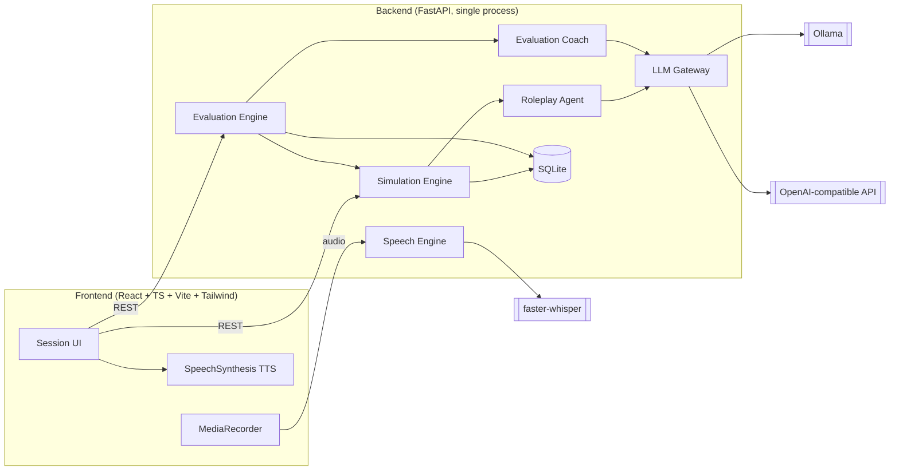
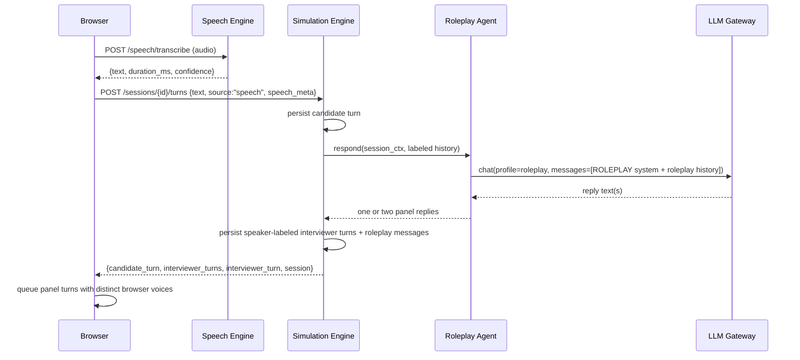
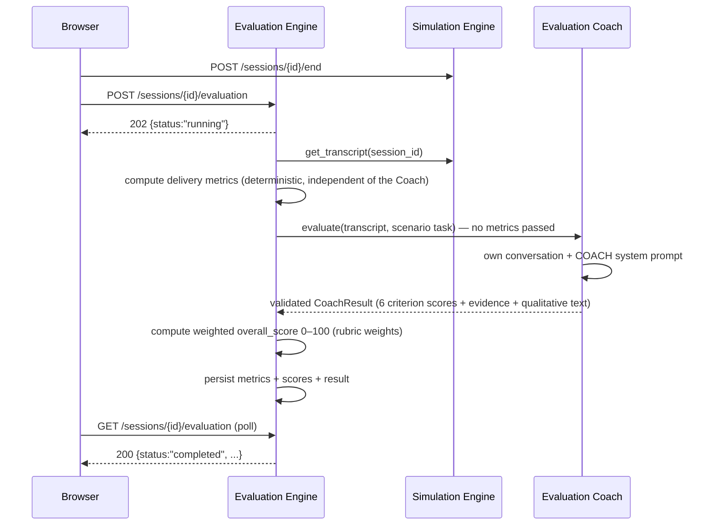

# Nene – System Architecture

| | |
|---|---|
| Status | **Approved v0.3 architecture; see [current project status](../PROJECT_STATUS.md) for implementation and acceptance gaps.** |
| Version | 0.3.0 (API contract v0.4.0) |
| Owner | Principal Architect / Tech Lead |
| Related | [API contracts](../api-contracts/API_CONTRACTS.md), [Database schema](./database-schema.md), [Development plan](./development-plan.md) |

---

## Change Log

| Version | Changes |
|---|---|
| 0.3.0 | Review fixes: `LLMClient.model_for(profile)` added so services can record the configured model when creating a conversation row, without agents ever naming a model (§4 M2, §7.8). `SESSION_IDLE_TIMEOUT_MINUTES` added to configuration; idle-timeout behaviour defined in API_CONTRACTS §6.9 (§6, §7.3). Consistency with DATABASE_SCHEMA v0.3 (Coach receives no metrics; evaluation conversations are per attempt). |
| 0.2.0 | **LLM:** no model name in application logic; model chosen by env; gateway resolves *profiles*, agents never name a model (§4 M2, §7.3, §7.8). Hardware tiers and fallback ladder (§7.10). Model benchmarking gate before the demo model is locked (§7.11). **Speech:** English-only, `WHISPER_MODEL` env, CPU fallbacks, speech module import-isolated (§4 M5, §7.9). **Evaluation:** explicit weighted rubric; backend computes overall 0–100; LLM returns only criterion scores + evidence; delivery metrics are deterministic and kept separate and are *not* given to the Coach (§4 M6, §7.13). **Interaction:** push-to-talk, non-streaming, no WebSocket/SSE, with explicit revisit trigger (§7.12). Open questions resolved into a decisions log (§11). |
| 0.1.0 | Initial draft. |

---

## 0. Repository Inspection Result

Repository inventory completed after v0.3 approval:

| Existing path | Observed content | Mapping / action |
|---|---|---|
| `README.md`, `LICENSE` | Project introduction and license | Keep; expand the README with the approved setup quickstart |
| `.env.example` | Empty | Populate with environment-variable names only |
| `backend/app/{agents,api,core,database,evaluation,services,simulation}/` | Empty directories before Phase 0 | Preserve; the approved modules are scaffolded under `backend/app/` |
| `backend/test/`, `frontend/` | Empty directories before Phase 0 | Preserve legacy placeholders; use `backend/tests/` and the Vite app under `frontend/` |
| `docs/architecture/`, `docs/api-contracts/` | Four approved v0.3 specifications, organized by topic | Keep as the source of truth |
| `.git/` | Existing Git repository on `contracts/foundation` | Keep; worktree contains pre-existing documentation changes which are not staged or discarded |

No application code or working behavior existed to migrate. Decision D6 is closed: retain the existing root and documentation, preserve the empty legacy directories, organize the four specifications under `docs/architecture/` and `docs/api-contracts/`, and scaffold the module paths below.

---

## 1. Goals, Non‑Goals, Principles

### Goals
- Real-time, spoken, high-pressure interview roleplay with independent post-session evaluation.
- Supports fully local inference with Ollama or a configured OpenAI-compatible provider; faster-whisper, SQLite, and browser TTS remain local.
- Parallel development by several developers with zero contract ambiguity.

### Non‑Goals (MVP)
Authentication/multi-user accounts, cloud deployment, paid APIs, server-side TTS, streaming of any kind (SSE/WebSocket/streamed audio), continuous listening / voice-activity detection / barge-in, scenario authoring UI, non-English languages, analytics dashboards, mobile apps.

### Principles
1. **Contracts first.** `API_CONTRACTS.md` and the Pydantic schemas derived from it are the single source of truth. Nobody invents fields.
2. **Hard agent isolation.** Roleplay Agent and Evaluation Coach never share a system prompt, conversation ID, or message history (enforced in code *and* in the DB schema).
3. **One-way module dependencies.** Modules talk only through documented Python interfaces (internal) or REST (frontend ↔ backend).
4. **Simple first.** Monolithic FastAPI app, modular internals, synchronous SQLite, no message broker, no microservices.
5. **Stateless LLM calls.** The selected provider receives explicit history supplied from our DB and holds no application session state.
6. **Models are configuration, not code.** Model names live only in environment variables. Agents request an LLM *profile* (`roleplay` / `evaluation`); only the LLM Gateway maps a profile to a model.
7. **The backend owns every number.** The LLM judges (criterion scores + evidence); deterministic code computes metrics and the final weighted score.

---

## 2. Repository Layout

```
echorole/
├── backend/
│   ├── app/
│   │   ├── main.py                  # FastAPI factory, router mounting, lifespan
│   │   ├── core/                    # M1 Platform
│   │   │   ├── config.py            # pydantic-settings (env)
│   │   │   ├── errors.py            # AppError + error codes + handlers
│   │   │   ├── db.py                # engine, session, pragmas
│   │   │   ├── ids.py               # prefixed id generation
│   │   │   └── logging.py           # request_id middleware
│   │   ├── llm/                     # M2 LLM Gateway
│   │   │   ├── client.py            # OllamaClient + OpenAICompatibleClient
│   │   │   ├── interfaces.py        # LLMClient protocol and shared types
│   │   │   └── fake.py              # FakeLLMClient (tests, parallel dev)
│   │   ├── roleplay/                # M3 Roleplay Agent
│   │   │   ├── agent.py             # RoleplayAgent
│   │   │   └── prompts.py           # ROLEPLAY system prompt builder
│   │   ├── simulation/              # M4 Simulation Engine
│   │   │   ├── router.py            # /scenarios, /sessions
│   │   │   ├── service.py           # session lifecycle, turn orchestration
│   │   │   ├── scenarios/           # seed scenario JSON files
│   │   │   └── repository.py
│   │   ├── speech/                  # M5 Speech Engine
│   │   │   ├── router.py            # /speech/*
│   │   │   └── stt.py               # faster-whisper wrapper (+ fake)
│   │   ├── evaluation/              # M6 Evaluation Engine
│   │   │   ├── router.py            # /sessions/{id}/evaluation
│   │   │   ├── service.py           # orchestration, persistence
│   │   │   ├── coach.py             # EvaluationCoach
│   │   │   ├── prompts.py           # COACH system prompt builder
│   │   │   ├── metrics.py           # deterministic delivery metrics
│   │   │   └── rubric.py            # criteria, weights, band descriptions (single source)
│   │   ├── schemas/                 # Pydantic models = API contract
│   │   └── models/                  # SQLAlchemy ORM
│   ├── migrations/                  # Alembic
│   ├── tools/benchmark_llm.py       # model benchmarking harness (dev tool)
│   ├── tests/{unit,integration,contract,llm_eval}/
│   └── pyproject.toml
├── frontend/                        # M7
│   ├── src/
│   │   ├── api/                     # typed client (generated types + fetch wrapper)
│   │   ├── mocks/                   # MSW handlers matching API_CONTRACTS.md
│   │   ├── features/{scenarios,session,feedback}/
│   │   ├── hooks/                   # useRecorder, useSpeechSynthesis
│   │   └── components/
│   └── package.json
├── docs/
│   ├── api-contracts/
│   │   ├── API_CONTRACTS.md
│   │   └── examples/                   # canonical JSON examples
│   └── architecture/
│       ├── database-schema.md
│       ├── development-plan.md
│       └── system-architecture.md
├── CODEOWNERS
└── README.md
```

---

## 3. High-Level Architecture



### Typical flow (one spoken turn)



### Evaluation flow



---

## 4. Module Boundaries and Responsibilities

### M1 – Platform (`core/`, `schemas/`, `models/`, `migrations/`)
- **Owns:** config, DB engine/session, Alembic migrations, ORM models, Pydantic schemas (contract mirror), `AppError` + exception handlers, request-ID middleware, ID generation, `/health`.
- **Must not:** contain business logic.
- **Exposes:** `get_db()`, `AppError`, `new_id(prefix)`, all schema classes.

### M2 – LLM Gateway (`llm/`)
- **Owns:** the only code that talks to Ollama or the configured OpenAI-compatible endpoint **and the only code that knows model names**. Selects the provider and resolves a *profile* (`roleplay` | `evaluation`) to a model plus generation parameters from configuration (§7.3, §7.8); handles timeouts, retryable failures, JSON mode, context-size guard, and provider health checks.
- **Must not:** know about roleplay, evaluation, sessions or prompt content.
- **Switching models is a configuration change only.** Agents pass a profile, never a model name, so changing models requires no edits to the Roleplay Agent or Evaluation Coach.
- **Interface:**

```python
class LLMProfile(str, Enum):
    ROLEPLAY = "roleplay"
    EVALUATION = "evaluation"

class LLMMessage(TypedDict):
    role: Literal["system", "user", "assistant"]
    content: str

class LLMClient(Protocol):
    def chat(self, *, profile: LLMProfile, messages: list[LLMMessage],
             json_mode: bool = False) -> LLMResult: ...
    def health(self) -> LLMHealth: ...
    def model_for(self, profile: LLMProfile) -> str: ...   # pure config read; called by services (M4, M6) when creating a conversation row. Agents never call it

class LLMResult(BaseModel):
    content: str
    model: str                    # model actually used – persisted for audit
    profile: LLMProfile
    prompt_tokens: int | None
    completion_tokens: int | None
    latency_ms: int
```
- **Errors raised:** `LLM_UNAVAILABLE`, `LLM_TIMEOUT`, `LLM_MODEL_NOT_FOUND`, `LLM_BAD_OUTPUT`.

### M3 – Roleplay Agent (`roleplay/`)
- **Owns:** one legacy interviewer or a two-person panel. Builds a persona-specific ROLEPLAY system prompt from a `Scenario`; schedules opening, paired, and alternating replies; labels conversation history; trims history to the context budget; enforces in-character, short, spoken-style replies.
- **Must not:** persist anything, read the DB, give feedback/coaching, see evaluation data, or share state with the Coach.
- **Interface:**

```python
class RoleplayContext(BaseModel):
    session_id: str
    conversation_id: str          # roleplay conversation – never the coach's
    scenario: ScenarioOut
    history: list[LLMMessage]     # roleplay-conversation messages only (no system)
    turn_index: int
    max_turns: int

class RoleplayAgent:
    def __init__(self, llm: LLMClient): ...
    def open_session(self, ctx: RoleplayContext) -> RoleplayReply | list[RoleplayReply]: ...
    def respond(self, ctx: RoleplayContext, candidate_text: str) -> RoleplayReply | list[RoleplayReply]: ...

class RoleplayReply(BaseModel):
    text: str
    should_end: bool              # persona signals the interview is naturally over
    llm: LLMMeta                  # model, latency, tokens (for logging only)
    speaker_id: str | None
    speaker_name: str | None
```

### M4 – Simulation Engine (`simulation/`)
- **Owns:** scenario catalogue (seeded from JSON), session lifecycle and state machine, turn orchestration, transcript storage, roleplay conversation + message persistence, concurrency guard (one in-flight turn per session), session limits (`max_turns`).
- **Must not:** build prompts, call Ollama directly, compute scores.
- **Exposes (internal) to M6:**

```python
class SimulationService:
    def get_transcript(self, session_id: str) -> Transcript: ...   # ordered turns + scenario + session meta
    def assert_session_ended(self, session_id: str) -> None: ...   # raises SESSION_NOT_ENDED
```

### M5 – Speech Engine (`speech/`)
- **Owns:** English speech-to-text with faster-whisper (lazy-loaded singleton with background warm-up), audio validation and decoding to 16 kHz mono, size/duration limits, timing and confidence metadata, the `/speech/*` endpoints. Language is fixed to English (`en`) in the MVP. The model is selected by `WHISPER_MODEL` (§7.9). Text-to-speech is **browser-only**; the backend has no TTS endpoint.
- **Independent by design:** audio in, text out. The module does not import `roleplay`, `simulation`, `evaluation` or `llm`, does not know sessions exist, and never touches the DB. The browser is the only thing that connects a transcript to a turn (`POST /sessions/{id}/turns`). An import-lint test enforces this.
- **Must not:** persist audio.
- **Interface:**

```python
class SpeechEngine(Protocol):
    def transcribe(self, audio: bytes, content_type: str) -> Transcription: ...
    def status(self) -> SpeechStatus: ...
```

### M6 – Evaluation Engine (`evaluation/`)
Three parts with strict boundaries:

1. **Delivery Metrics (`metrics.py`)** – deterministic code over the transcript and `speech_meta` (word counts, words-per-minute, filler words as transcribed, STT confidence). No LLM, no judgement, no score.
2. **Evaluation Coach (`coach.py`)** – an LLM agent with its **own** system prompt (COACH), **own** conversation (`agent_role='evaluation'`, new row per attempt) and **own** history. Input: rendered transcript (turn ids + text), the scenario task, and the rubric descriptions. Output: a JSON `CoachResult` containing six integer criterion scores (0–10) with rationale and evidence turn ids, plus qualitative feedback. It **never** produces an overall score or weights, and it **does not receive** delivery metrics (qualitative judgement and deterministic metrics stay separate end to end).
3. **Evaluation Service (`service.py`, `rubric.py`)** – orchestrates: load transcript from M4 → compute metrics → call Coach → validate `CoachResult` → compute `overall_score` (0–100) from the rubric weights → persist → manage status. `rubric.py` is the single source for criteria, weights and band descriptions; the Coach prompt is generated from it.

- **Must not:** modify sessions/turns; reuse the Roleplay prompt or history; call Ollama directly; trust any score the LLM volunteers beyond the six criterion scores.
- **Interface:**

```python
class EvaluationCoach:
    def __init__(self, llm: LLMClient): ...
    def evaluate(self, ctx: CoachContext) -> CoachOutput: ...   # one corrective retry on invalid output

class CoachContext(BaseModel):
    evaluation_id: str
    conversation_id: str          # coach conversation – never the roleplay's
    scenario: ScenarioOut
    transcript: list[TurnOut]
    # deliberately no metrics field

class CoachOutput(BaseModel):
    result: CoachResult           # validated; no overall_score
    llm: LLMMeta

def compute_overall_score(criteria: list[CriterionScoreIn]) -> int: ...   # rubric.py, pure, deterministic
```

### M7 – Frontend (`frontend/`)
- **Owns:** scenario picker with panel identities; session screen with the **push-to-talk** flow (§7.12), transcript view, typed-input fallback, queued two-voice interviewer TTS via `SpeechSynthesis`; end-session and feedback screens (qualitative feedback panel and delivery-metrics panel shown separately); typed API client; MSW mocks.
- **Must not:** call Ollama or Whisper directly; invent request fields; compute scores. Types are generated from the backend OpenAPI schema (`openapi-typescript`).

---

## 5. Agent Isolation (Critical Constraint)

| Aspect | Roleplay Agent | Evaluation Coach |
|---|---|---|
| System prompt | `roleplay/prompts.py` → `build_roleplay_prompt(scenario)` | `evaluation/prompts.py` → `build_coach_prompt(rubric)` |
| Conversation row | `conversations(agent_role='roleplay')`, **1 per session** (partial unique index) | `conversations(agent_role='evaluation')`, **1 per evaluation attempt** |
| Conversation ID prefix | `cnv_rp_…` | `cnv_ev_…` |
| Message history | `messages` rows of its own conversation | `messages` rows of its own conversation |
| Sees | Persona, scenario, candidate/interviewer dialogue so far | Full finished transcript (turn ids + text), task goal/criteria, rubric descriptions. **Not** the delivery metrics |
| Never sees | Rubric, scores, Coach output | Roleplay system prompt, persona hidden instructions |
| LLM profile | `roleplay` (higher temperature, short outputs) | `evaluation` (low temperature, JSON mode). Parameters live in config, never in agent code |
| Output | Plain spoken text | JSON validated against `CoachResult` (criterion scores + evidence + qualitative text; **no** overall score) |
| Runs | During session | After session ended |

Enforcement:
1. DB: `messages.conversation_id` FK; `conversations.agent_role` CHECK; partial unique index for roleplay.
2. Code: `LLMClient.chat()` receives `messages` built *only* from one conversation. Each agent's `build_*` function lives in its own module; a unit test greps that neither module imports the other.
3. Contract tests: assert `roleplay_conversation_id != evaluation.conversation_id` and that no coach message content contains the roleplay system prompt string.

---

## 6. Session State Machine

```mermaid
stateDiagram-v2
  [*] --> created: POST /sessions
  created --> active: POST /sessions/{id}/start
  active --> active: POST /sessions/{id}/turns
  active --> ended: POST /sessions/{id}/end  or max_turns reached
  active --> abandoned: idle timeout (SESSION_IDLE_TIMEOUT_MINUTES, default 60; checked lazily — API_CONTRACTS §6.9)
  ended --> [*]
```



Evaluation has its own status: `pending → running → completed | failed`. A failed evaluation can be retried (`POST …/evaluation` again creates a new attempt).

---

## 7. Cross-Cutting Conventions

### 7.1 Error handling (summary; full spec in API_CONTRACTS §2)
Every non-2xx response uses the envelope `{"error": {"code", "message", "details", "request_id"}}`. Modules raise `AppError(code, message, http_status, details)`; a single FastAPI handler formats it. Unhandled exceptions → `INTERNAL_ERROR` (500) with no stack trace in the body, full trace in logs.

### 7.2 IDs & time
Prefixed UUID4 hex (`ses_…`, `trn_…`, `scn_…`, `cnv_rp_…`, `cnv_ev_…`, `msg_…`, `evl_…`). Timestamps ISO‑8601 UTC with `Z`.

### 7.3 Configuration (environment variables; `.env.example` committed with names only)
Validated at startup by `core/config.py` (pydantic-settings); invalid or missing required values stop the app with a clear message. **No model name appears in application logic, prompts or tests** — only in `.env.example`, documentation, and the benchmark tool's candidate list. Tests set `OLLAMA_MODEL` to a dummy value and use `FakeLLMClient`.

| Variable | Required | Default | Purpose |
|---|---|---|---|
| `ECHOROLE_DB_URL` | no | `sqlite:///./data/echorole.db` | Database |
| `CORS_ORIGINS` | no | `http://localhost:5173` | Allowed origins |
| `OLLAMA_BASE_URL` | no | `http://localhost:11434` | Ollama endpoint |
| `LLM_PROVIDER` | no | Code default `ollama`; `.env.example` selects `openai_compatible` | Select `ollama` or `openai_compatible` |
| `OPENAI_BASE_URL` | for cloud provider | Code default is OpenAI; `.env.example` uses Groq | OpenAI-compatible chat-completions base URL |
| `OPENAI_API_KEY` | for cloud provider | *(empty)* | Provider key; must not be logged or persisted |
| `OPENAI_MODEL` | for cloud provider | No code default; `.env.example` has a sample ID | Configured cloud model name; verify account access |
| `OLLAMA_MODEL` | when `LLM_PROVIDER=ollama` | *(none – no code default)* | Model used by all profiles unless overridden |
| `OLLAMA_MODEL_ROLEPLAY` | no | falls back to `OLLAMA_MODEL` | Override for the `roleplay` profile |
| `OLLAMA_MODEL_EVALUATION` | no | falls back to `OLLAMA_MODEL` | Override for the `evaluation` profile |
| `OLLAMA_NUM_CTX` | no | `4096` | Context window requested from Ollama |
| `LLM_TIMEOUT_S` | no | `60` | Per-call timeout |
| `ROLEPLAY_TEMPERATURE` / `ROLEPLAY_MAX_TOKENS` | no | `0.8` / `160` | Roleplay generation parameters |
| `EVALUATION_TEMPERATURE` / `EVALUATION_MAX_TOKENS` | no | `0.2` / `1500` | Coach generation parameters |
| `ROLEPLAY_HISTORY_TURNS` | no | `12` | Max past exchanges sent to the Roleplay Agent |
| `WHISPER_MODEL` | no | `small` | faster-whisper model name (§7.9) |
| `WHISPER_DEVICE` | no | `auto` | `auto` / `cpu` / `cuda` |
| `WHISPER_COMPUTE_TYPE` | no | `default` | e.g. `int8` for CPU, `float16` for GPU |
| `MAX_AUDIO_SECONDS` / `MAX_AUDIO_MB` | no | `120` / `10` | Upload limits |
| `SESSION_IDLE_TIMEOUT_MINUTES` | no | `60` | Idle time after which an active session is lazily abandoned |

The numeric defaults are generation tunables, not model choices; they may be changed by the benchmark outcome (§7.11).

### 7.4 Logging
Structured JSON logs; `X-Request-ID` header accepted or generated and echoed on every response. Never log full transcripts at INFO.

### 7.5 Privacy
Speech recognition and database storage are local. Audio is never stored;
transcripts and results are stored in local SQLite. When an OpenAI-compatible
cloud provider is selected, prompts and transcript text are sent to that
provider for generation; use the provider's data policy when deciding what
content to submit.

### 7.6 Performance budget (targets; validated by the benchmark, §7.11)
Measured on the target hardware tier (§7.10), not on any model assumption:
- STT ≤ 3 s for a 15 s utterance on Tier A/B; ≤ 6 s on Tier C.
- Roleplay reply: p95 ≤ 8 s (hard limit 15 s).
- Full push-to-talk turn (STT + LLM, excluding user speech): p95 ≤ 12 s.
- Evaluation: ≤ 60 s target (async, polled); > 120 s is a fail.

### 7.7 Testing pyramid
Unit (per module, with `FakeLLMClient` / fake STT) → contract tests (responses validate against schemas) → integration (real SQLite, fake LLM) → one manual E2E with real Ollama + Whisper.

### 7.8 LLM configuration and model switching
- **Single point of model knowledge.** `llm/client.py` holds a `ProfileConfig` per profile: `{model, temperature, max_tokens, num_ctx, timeout_s}`, built from §7.3. Agents call `chat(profile=…)`.
- **To switch providers/models:** for Ollama, pull the model and edit `OLLAMA_MODEL`; for an OpenAI-compatible provider, configure `OPENAI_BASE_URL`, `OPENAI_MODEL`, and `OPENAI_API_KEY`. Restart the backend after changing `.env`. No prompt, schema or migration change is needed. The configured model is recorded in `conversations.model` and `evaluations.model`, so historical results stay interpretable.
- **Model-agnostic prompts.** Prompts use plain chat roles and avoid model-specific templates or tokens (Ollama applies each model's chat template). Behavioural requirements are verified, not assumed, by the opt-in LLM behaviour suite (`pytest -m llm`, §7.11) against whatever model is configured.
- **Recording the model.** Services (M4 for the roleplay conversation, M6 for each evaluation conversation) store `model_for(profile)` in the new row; `LLMResult.model` is stored in turn/evaluation metadata. Neither agent ever sees or passes a model name.
- **One model by default.** `OLLAMA_MODEL_EVALUATION` exists so a stronger model can score sessions asynchronously, but using two models on a memory-limited machine forces Ollama to swap models (extra load time). The default and recommendation is a single model for both profiles.
- **Health.** `/health` reports the active provider's status and whether each configured model is available. Model errors use provider-specific guidance; Ollama errors include the `ollama pull` hint.

### 7.9 Speech configuration (English-only MVP)
- Language is fixed to English. Non-`.en` models are invoked with `language="en"` forced (no auto-detect, so no wrong-language drift).
- `WHISPER_MODEL` accepts any model name supported by faster-whisper. **Initial candidate: `small`.** Fallbacks for CPU-constrained machines:

| Option | Parameters | Use when | Trade-off |
|---|---|---|---|
| `small` (initial candidate) | ≈244 M | Tier A/B hardware | Best accuracy/latency balance of the options here for CPU use with int8 |
| `small.en` | ≈244 M | English-only deployments wanting slightly better English accuracy | English-only variant |
| `base` / `base.en` | ≈74 M | Tier C, or `small` exceeds the STT latency budget | Faster, noticeably more recognition errors |
| `tiny.en` | ≈39 M | Last-resort CPU-constrained fallback | Fastest; error-prone on accents and jargon |
| `medium.en` | ≈769 M | GPU only | Higher accuracy; too slow on CPU |

- Use `WHISPER_COMPUTE_TYPE=int8` on CPU. The final STT model is chosen by measuring on the target machine (§7.11), with `small` as the starting point.
- Recognition errors reach the Coach as text. The Coach prompt tells it to ignore likely transcription artefacts (punctuation, odd spellings) when judging language accuracy, and the UI lets the user edit the transcript before sending.

### 7.10 Hardware requirements and fallback options
Software: Python 3.11+, Node 20+; Ollama and model disk space are needed only for local inference. **The figures below are planning estimates for typical 4-bit-quantised Ollama models; the benchmark (§7.11) replaces them with measured numbers for the actual demo machine.**

| Tier | Machine | LLM class (illustrative candidates) | STT | Expectation |
|---|---|---|---|---|
| **A – Recommended** | ≥16 GB RAM and a GPU with ≥8 GB VRAM, or Apple Silicon with ≥16 GB unified memory | 7–8 B class (e.g. `llama3.1:8b`, `qwen2.5:7b`) | `small`, GPU or int8 | Best roleplay realism and most reliable JSON from the Coach; within the latency budget |
| **B – Standard CPU** | ≥16 GB RAM, 6+ cores, no GPU | 3 B class (e.g. `llama3.2:3b`, `qwen2.5:3b`); a 7–8 B model only if the benchmark shows it meets the latency budget | `small` int8 | Usable; weaker persona consistency; 7–8 B on CPU is expected to be slow |
| **C – Constrained** | 8 GB RAM, ≈4 cores | 1–3 B class (e.g. `llama3.2:1b`, `qwen2.5:1.5b`, or a 3 B model if memory allows) | `base.en` or `tiny.en` | Demo-grade; Coach JSON reliability is the main risk → rely on validation + retry |

Fallback ladder (apply in order until the budget in §7.6 is met):
1. Choose a smaller model of the same family (`OLLAMA_MODEL`).
2. Lower `OLLAMA_NUM_CTX` (e.g. 4096 → 2048) and `ROLEPLAY_HISTORY_TURNS`.
3. Lower `ROLEPLAY_MAX_TOKENS` (shorter replies are also better for spoken roleplay).
4. Choose a smaller Whisper model (§7.9).
5. If one machine cannot run the chosen model at all, run Ollama on a second local-network machine via `OLLAMA_BASE_URL` (still no paid service).
Candidate model names above are illustrative inputs to the benchmark, not commitments.

### 7.11 Model benchmarking gate (before the demo model is finalised)
- **Tool:** `backend/tools/benchmark_llm.py --models <a,b,c> --whisper <x,y> --runs N`, plus the opt-in behaviour suite `pytest -m llm`. It reuses the real Roleplay Agent, Evaluation Coach and Gateway (so it tests what ships) with fixed fixtures: 3 scenarios × scripted candidate dialogues (strong, average, weak) and the 3 fixture transcripts.
- **Output:** `docs/architecture/LLM_BENCHMARK.md` (created when the benchmark is run, in Phase 2) recording hardware, model list, results, and the chosen model, which then becomes the recommended value in `.env.example`.
- **Pass criteria (per model, on the target machine):**

| Area | Metric | Pass |
|---|---|---|
| Roleplay latency | reply p95 | ≤ 8 s (fail > 15 s) |
| Roleplay format | replies ≤ 60 words | ≥ 90 % |
| Roleplay format | markdown / stage directions | 0 |
| Roleplay behaviour | in character, no coaching, one question per turn, challenges vague answers (reviewer check on ≥ 20 sampled turns) | ≥ 80 % |
| Coach validity | valid `CoachResult` on first try (20 runs) | ≥ 90 % |
| Coach validity | valid after one retry | ≥ 98 % |
| Coach evidence | evidence ids that exist in the transcript | ≥ 95 % |
| Coach discrimination | overall score gap, strong − weak fixture | ≥ 15 points |
| Coach stability | std-dev of overall score, same transcript | ≤ 8 points |
| Coach latency | evaluation time | ≤ 60 s (fail > 120 s) |
| Resources | peak RAM/VRAM, model load time | recorded, must fit the tier |
| STT | latency on a 15 s clip; WER sanity on 3 clips | ≤ 3 s (Tier A/B); WER ≤ 15 % |

- **Decision rule:** select the *smallest* model meeting every pass criterion on the target tier; if none does, apply the fallback ladder (§7.10) and re-run; if still none, raise to the architect before proceeding. Per-profile models are considered only if a single model fails exactly one profile.
- **Gate:** the demo model is locked only after this step; MVP sign-off (DEVELOPMENT_PLAN Phase 2) requires `LLM_BENCHMARK.md`.

### 7.12 MVP interaction model (push-to-talk, non-streaming)
- **Push-to-talk:** the user presses and holds a mic button to record (click-to-toggle offered as the accessibility alternative; same state machine). No continuous listening, no voice-activity detection, no barge-in.
- **Flow:** `idle → recording → transcribing → review (editable text) → sending → waiting_reply → speaking (TTS) → idle`. The mic is disabled during `waiting_reply` and `speaking`. Recording is hard-stopped at `MAX_AUDIO_SECONDS`. No auto-send in the MVP: the user confirms the transcript. Typed input remains available.
- **Transport:** plain request/response REST. Roleplay replies are returned whole; the browser then speaks the full reply with `SpeechSynthesis`. Evaluation is HTTP 202 + polling every 2 s.
- **No WebSockets and no SSE.** **Revisit trigger:** only if, after the benchmark and the fallback ladder, the p95 full-turn latency on the target hardware still exceeds 12 s, the architect may propose one-way SSE token streaming for roleplay replies (never WebSockets), as a contract-change PR.

### 7.13 Evaluation rubric (summary — authoritative text in API_CONTRACTS §8.1)
- Six criteria scored as **integers 0–10** by the Coach: relevance, structure, clarity, composure, conciseness, language_accuracy.
- **Fixed weights (sum 100 %):** relevance 25, structure 20, clarity 20, composure 15, conciseness 10, language_accuracy 10.
- **`overall_score` (0–100) is computed by the backend:** `(Σ weight_percent × score + 5) // 10` (integer, half-up). The LLM never returns, and the backend never accepts, a final score from the model.
- **Qualitative vs deterministic:** `result` (Coach judgement) and `metrics` (deterministic delivery numbers) are separate objects in the API, separate in storage, and separate in the UI. Metrics are never inputs to the weighted score or to the Coach in the MVP.
- Weights, band descriptions and `rubric_version` live in `evaluation/rubric.py`; changing them is a contract change.

---

## 8. Git & Integration Strategy

**Model:** trunk-based with short-lived branches. `main` is always releasable and protected (PR + 1 review + green CI). Phase 0 is being implemented on `contracts/foundation`; branch-protection settings are documented in the README because they cannot be enabled from a local checkout.

| Branch | Purpose |
|---|---|
| `main` | Integrated, working code |
| `contracts/foundation` | Phase 0: contracts, schemas, scaffold. Merged first |
| `feat/<module>-<topic>` | e.g. `feat/simulation-session-lifecycle`, `feat/speech-transcribe` |
| `fix/<module>-<topic>` | bug fixes |
| `contract/<topic>` | **only** way to change API contracts (see below) |

Rules:
1. **No branch starts module work until `contracts/foundation` is merged.**
2. **Contract changes** require a PR labelled `contract-change` that updates `API_CONTRACTS.md` **and** `backend/app/schemas/` **and** the MSW mocks in the same PR, approved by the tech lead and by the owner of every consuming module. `API_CONTRACTS.md` has a version header; bump semver (`0.x` until MVP).
3. `CODEOWNERS` maps each module directory to its owner; `docs/api-contracts/` and `backend/app/schemas/` are owned by the tech lead.
4. Each PR touches **one module directory** (plus its tests). Cross-module edits are split into separate PRs.
5. Merge with squash; Conventional Commits (`feat(simulation): …`). Rebase on `main` daily.
6. CI (GitHub Actions or equivalent): `ruff` + `mypy` + `pytest` (backend), `tsc` + `eslint` + `vitest` (frontend), contract test job, OpenAPI → TS type drift check (fails if generated types differ from committed).
7. Integration checkpoints at end of each phase: tech lead cuts a tag `phase-N` on `main`.
8. Feature flags are not used; incomplete features stay behind unmounted routers until their phase.

### Parallel-work safety nets
- `FakeLLMClient` and fake STT ship in Phase 0 so no module blocks on Ollama/Whisper.
- Frontend develops against MSW mocks generated from the contract examples.
- Fixture transcripts (`backend/tests/fixtures/transcripts/*.json`) let the Evaluation module work without a running Simulation Engine.

---

## 9. Technology Decisions

| Concern | Choice | Reason |
|---|---|---|
| ORM / migrations | SQLAlchemy 2.0 + Alembic | Standard, typed, SQLite-friendly |
| Validation | Pydantic v2 | Native to FastAPI; schema = contract |
| Background work | FastAPI `BackgroundTasks` for evaluation | No broker needed; single process |
| SQLite mode | WAL, `foreign_keys=ON`, `busy_timeout=5000` | Concurrent reads during writes |
| HTTP client for Ollama | `httpx` | Timeouts, simple |
| Audio decode | `faster-whisper` built-in PyAV decoding | Avoids ffmpeg binary dependency |
| Frontend state | React Query + local component state | No global store needed |
| Frontend types | `openapi-typescript` from `/openapi.json` | Prevents contract drift |
| Streaming (SSE/WebSocket) | **Not used in MVP** | Non-streaming turns; revisit only on the §7.12 trigger |
| Voice interaction | Push-to-talk + browser `SpeechSynthesis` | Simplest reliable model; no VAD or barge-in |
| LLM model choice | Environment variable, benchmark-gated | §7.8, §7.11 |

---

## 10. Risks & Mitigations

| Risk | Mitigation |
|---|---|
| Local LLM latency makes roleplay feel slow | Benchmark gate (§7.11), fallback ladder (§7.10), short-reply prompt, token cap, history trimming, UI "thinking" state |
| No model meets quality *and* latency on the demo machine | Per-profile models (§7.8), second-machine Ollama via `OLLAMA_BASE_URL`, lower expectations documented per tier; decision escalated to architect |
| Coach returns invalid JSON or unstable scores | JSON mode, strict validation, one corrective retry, `EVALUATION_PARSE_FAILED` + retry endpoint; benchmark checks stability and discrimination; scoring arithmetic is deterministic |
| Prompt cross-contamination between agents | Isolation rules §5 + tests |
| Contract drift between docs, Pydantic, DB and mocks | Schemas-as-source, canonical JSON examples, parity tests, CI drift check (DEVELOPMENT_PLAN P0.12–P0.14) |
| Roleplay agent "helps" the candidate | Prompt rule + automated check for coaching phrases |
| Whisper errors distort evaluation | Editable transcript before sending; Coach told to ignore transcription artefacts; metrics labelled approximate |
| Whisper omits filler words, so filler metrics under-count | Metric documented as "as transcribed"; not used in scoring |
| Text-only evaluation cannot observe tone/intonation | Stated limitation; `composure` judged from text only; audio analysis out of MVP scope |
| Cold-start (Whisper/Ollama model load) on first turn | Background warm-up; `/health` and `/speech/status` expose readiness; UI shows loading state |
| Model names leak into code over time | Lint test scanning for model-name literals outside the allow-list |

## 11. Decisions Log

| # | Decision | Status |
|---|---|---|
| D1 | Monolithic FastAPI app with isolated modules; repo layout §2 | Approved |
| D2 | Model names only in env; profile-based gateway; benchmark gate before locking the demo model | Approved (v0.2) |
| D3 | English-only MVP; Whisper model via env; `small` initial candidate with documented CPU fallbacks; speech module independent | Approved (v0.2) |
| D4 | Six criteria, 0–10 each; backend computes overall 0–100 using fixed weights (25/20/20/15/10/10); LLM returns scores + evidence only; metrics separate | Approved (v0.2) |
| D5 | Non-streaming roleplay; async evaluation (202 + polling); no WebSockets/streaming unless §7.12 trigger; push-to-talk | Approved (v0.2) |
| D6 | Existing repository reconciliation (§0) | **Closed** – inventory completed; empty legacy directories preserved and approved module layout adopted |